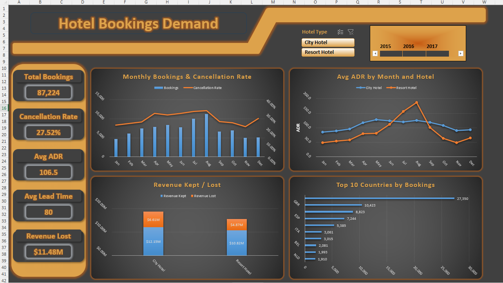
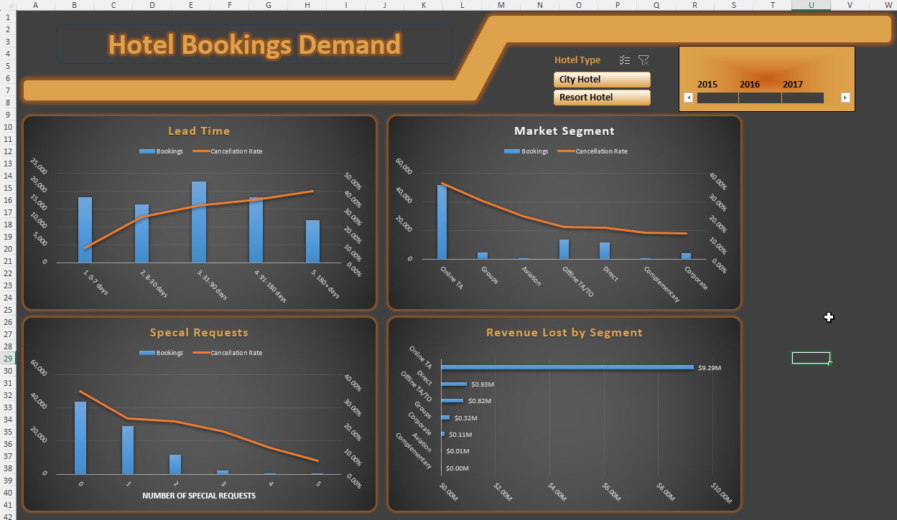

# hotel-bookings-cancellation-analysis

**Power Query | PivotTables | Excel Dashboard**

*An end-to-end analysis of 87,224 hotel bookings, identifying which bookings are most likely to cancel and estimating the revenue at risk.*

**Overview**

**Cancellation Drivers**

## Business Question
Cancellations cost hotels revenue and make occupancy hard to forecast.
**Which bookings are most likely to cancel, and what does it cost?**

## Dataset
- **Source:** https://www.kaggle.com/datasets/jessemostipak/hotel-booking-demand. Original paper: Antonio, Almeida and Nunes (2019), *Data in Brief*.
- **Content:** booking records for a city hotel and a resort hotel, and includes information such as when the booking was made, length of stay, the number of adults, children, and/or babies, and the number of available parking spaces, among other things.
- **Size:** 119,390 rows and 32 columns in the raw file; **87,224 rows** after cleaning.
- **Target Variable:** 'is_canceled' (1 = canceled).

## Tools
Excel (Power Query, PivotTables, PivotCharts, slicers).

## Data cleaning (Power Query)
| Step | Decision | Why |
|---|---|---|
| Trimmed and cleaned text columns | Removed leading, trailing spaces and non-printable characters from all text columns | Prevents values like "Resort Hotel  " and "Resort Hotel" from being treated as different values, which would split pivot categories and hide duplicate rows. Done before removing duplicates for that reason |
| Removed duplicates | Removed duplicate rows | Removed repeated rows, keeping one copy of each to avoid skewness in PivotTables and PivotCharts |
| Dropped columns | Removed unnecessary columns | (arrival_date_week_number), (company), (reservation_status) were removed from the dataset because they either didn't provide any useful information for the analysis or had most of their values missing |
| Merged columns | Combined all columns indicating dates to one | (arrival_date_year), (arrival_date_month), (arrival_date_day_of_month) were merged into one column called (arrival_date) |
| Text placeholders | `NULL` and `NA` converted to real values | The file stores missing values as text |
| `children` | `NA` replaced with 0 | Missing means no children |
| `meal` | `Undefined` replaced with SC | Undefined and SC both mean no meal package |
| `country` | `NULL` replaced with "Unknown" | Missing values in country replaced with Unknown in case data can be recovered in the future |
| `agent` | `NULL` replaced with "No-Agent" | Missing values indicate there was no agent |
| Types and Dates | Changed Dtypes to their appropriate ones | Many Dtypes changed from "text" to "whole number" with the exception of "adr" and "arrival_date" which were changed to "decimal" and "date" respectively |
| Custom Columns | Added calculated columns for the analysis | "total_guests" = "adults" + "children" + "babies", "total_nights" for the total nights stayed, "revenue" = "total_nights" * adr, "lead_time_bucket" |
| Filtered Rows | Removed rows with no meaning | bookings with "total_guests" = 0 or "adr" < 0 |

**Row count:** 119,390 raw, then **87,224** final.
**Deliberately kept:** bookings with `adr` = 0 and `total_nights` = 0, since they aren't clearly invalid.

The full M code is in [`power_query/hotel_bookings_clean.pq`](power_query/hotel_bookings_clean.pq).

## Analysis approach
Built PivotTables for each business question and connected hotel and year slicers across the dashboard. Two pages:
- **Overview:** KPIs, monthly demand, price seasonality, revenue kept vs lost, top countries.
- **Cancellation Drivers:** cancellation by lead time, market segment and special requests, plus estimated revenue lost by segment.
- **Key Findings:** one more bonus page listing major findings and possible suggestions.

*Revenue is estimated as average daily rate `adr` x nights; the dataset does not state the currency.*

## Key Findings
- **Overall:** 27.5% of bookings were cancelled.
- **Lead time is the strongest signal:** cancellation rises from 8.4% within a week to 39.7% at 180+ days.
- **Online TA:** the largest channel (59% of bookings), cancelling at 35.4% against 12-15% for Corporate, Direct and Offline TA/TO. ~81% of estimated revenue lost.
- **Special requests:** 33.3% with none, falling 10.6% within 4 requests.
- **Hotel:** the city hotel cancels more (30.1%) than the resort hotel (23.5%).
- **Customer type:** transient bookings cancel at 30.1%, group bookings at 9.8%.
- **Previous cancellations:** guests with one prior cancellation cancelled at 76.1% (1,405 bookings).
- **Parking spaces:** bookings requiring at least 1 required parking space almost never cancel (0% on 7,272 bookings).

## Recommendations (hypotheses to test)
1. Long led (over 30 days) Online TA bookings with no special requests might be the best group for deposit reconfirmation messages.
2. Flag guests with a previous cancellation as a high-risk group.
3. Any new cancellation policy should target Transient guests (71,861 bookings, with 30% cancellation rate).

## Limitations and open questions
- Revenue figures are estimates (no currency or actual payment data),
- Non-refundable bookings show a 94.7% cancellation rate on 1,038 bookings (city hotel: 97.2% on 845; resort hotel 83.9% on 193), the opposite of what's expected.
- Only 2 seasons of data, so seasonal claims are tentative.

## How to use this repo
- Open `excel/hotel_bookings_clean.xlsx` to explore the PivotTables and the Dashboard

## Author
Nick Papoutsis | www.linkedin.com/in/nick-papoutsis
